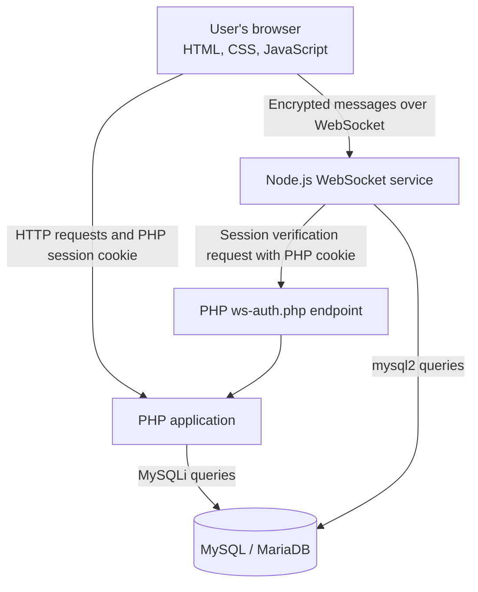

# MiChat

**MiChat** is a browser-based, one-to-one messaging application built with PHP, JavaScript, Node.js WebSockets, and MySQL. It combines PHP session-based account management with a separate Node.js service for real-time message delivery. Message contents are encrypted in the browser before they are sent to the server.

> **Project status:** This README describes the source snapshot supplied with the project. The project has not been independently security-audited or load-tested. Review the security notes below before deploying it for real users.

## Features

- User registration, login, logout, and session-based access to the chat dashboard.
- User search and conversation selection.
- Profile editing, including first name, last name, bio, and profile photo.
- Real-time one-to-one messaging through a WebSocket connection.
- Client-side message encryption using AES-GCM and RSA-OAEP.
- Separate encrypted AES keys for the sender and recipient, so both participants can decrypt a message.
- Message delivery and read receipts (single tick, double tick, and read/blue tick UI states).
- Optional disappearing-message timers. The expiry timer is set when a message is marked as seen.
- Block and unblock controls.
- Password-change screen.
- Export and import of browser encryption keys.

The current implementation is for **one-to-one conversations**. The WebSocket server also contains some room/demo handlers, but group chat is not implemented as a complete user-facing feature.

## Technology stack

| Layer | Technology |
|---|---|
| Frontend | HTML, CSS, vanilla JavaScript |
| PHP application | PHP and MySQLi |
| Real-time service | Node.js, Express, `ws` |
| Node.js database access | `mysql2` |
| Database | MySQL / MariaDB |
| Browser cryptography | Web Crypto API |
| Session authentication | PHP sessions, verified by the WebSocket service |

## Architecture



### Message encryption flow

1. During registration, the browser generates an RSA-OAEP key pair and stores the public and private JWK values in browser `localStorage`.
2. The public key is sent to PHP and stored in `user_public_keys`.
3. When a conversation opens, the browser retrieves the other participant's public key.
4. The browser generates a fresh AES-256-GCM key and a random 12-byte IV for the message.
5. The plaintext is encrypted with AES-GCM. The AES key is separately encrypted with RSA-OAEP for the sender and recipient.
6. The browser sends the encrypted message, both encrypted AES keys, and the IV to the Node.js service.
7. Node.js stores the encrypted payload and forwards it to the recipient's active WebSocket connection(s).
8. Each participant uses their private key in their own browser to decrypt the AES key and then the message.

The server stores ciphertext and encrypted AES keys; the normal message flow does not send the plaintext message body to PHP or Node.js.

## Repository structure

```text
MiChat/
├── index.php                  # Registration page
├── login.php                  # Login page
├── users.php                  # Main chat dashboard and WebSocket client setup
├── chat.php                   # Older/legacy chat page
├── edit-profile.php           # Profile editing page
├── settings.php               # Password and encryption-key settings
├── header.php                 # Shared page header and frontend dependencies
├── style.css                  # Authentication-page styles
├── css/
│   └── chat-app.css            # Main chat interface styles
├── javascript/
│   ├── crypto.js               # RSA/AES encryption and decryption helpers
│   ├── signup.js               # Registration and initial key generation
│   ├── login.js                # Login form handling
│   ├── users.js                # User list, search, and related UI
│   ├── dashboard.js            # Opens and loads conversation panels
│   ├── chat.js                 # Message sending, history, and receipt UI
│   ├── profile.js              # Profile-related frontend logic
│   ├── user-profile.js          # User profile and block/unblock UI
│   └── pass-show-hide.js        # Password visibility control
├── php/
│   ├── config.php              # PHP MySQL connection settings
│   ├── signup.php              # Registration endpoint
│   ├── login.php               # Login endpoint
│   ├── logout.php              # Logout endpoint
│   ├── ws-auth.php             # PHP session verification for WebSocket upgrades
│   ├── users.php               # User-list endpoint
│   ├── search.php              # User search endpoint
│   ├── chat-window.php         # Conversation panel markup/data
│   ├── get-chat.php            # Message-history endpoint
│   ├── save_public_key.php     # Stores a user's public key
│   ├── get_public_key.php      # Retrieves a user's public key
│   ├── block-user.php          # Block/unblock endpoint
│   ├── update-profile.php      # Profile update endpoint
│   ├── get-profile.php         # Profile data endpoint
│   ├── change-password.php     # Password change endpoint
│   └── images/                 # Uploaded profile images
└── websocket/
    ├── server.js               # WebSocket server and message lifecycle
    ├── package.json            # Node.js dependencies and scripts
    └── .env                    # Local WebSocket environment configuration (not for Git)
```

Some files (`chat.php`, `php/insert-chat.php`, `php/mark-seen.php`, and `php/data.php`) are older or parallel implementations. The main dashboard flow is centered on `users.php`, `javascript/dashboard.js`, `javascript/chat.js`, PHP history/profile endpoints, and `websocket/server.js`.

## Requirements

- Apache or another PHP-capable web server.
- PHP 8.2 or a compatible version with the `mysqli` extension enabled. The supplied database export was generated in a PHP 8.2 / MariaDB environment.
- MySQL or MariaDB with InnoDB and `utf8mb4` support.
- Node.js 18 or newer and npm. The WebSocket server uses Node's built-in `fetch` and `AbortSignal.timeout` APIs.
- A modern browser with Web Crypto API support.
- HTTPS in deployment. For local development, browsers generally permit Web Crypto on `localhost`.

## Local setup

The following steps assume XAMPP on Windows. Adapt the document-root and database commands if you use another environment.

### 1. Place the project in the web root

Clone the repository into your web server's document root. For XAMPP, an example location is:

```text
C:\xampp\htdocs\MiChat
```

Start Apache and MySQL from the XAMPP control panel. Open the PHP application at:

```text
http://localhost/MiChat/
```

### 2. Create and import the database

Create the database with the expected name and character set:

```sql
CREATE DATABASE chatapp
  CHARACTER SET utf8mb4
  COLLATE utf8mb4_general_ci;
```

Import the **latest MiChat SQL schema** into `chatapp` using phpMyAdmin or the MySQL command line. For example, after placing the latest export in `database/chatapp.sql`:

```bash
mysql -u root -p chatapp < database/chatapp.sql
```

**Important:** The ZIP snapshot contains an older file named `chatapp (1).sql`. It predates the disappearing-message and key-backup schema changes. Do not use that older dump for this version. Use the updated SQL export supplied separately with the project (the November 16, 2026 export, named `chatapp (3).sql` at upload time). Before publishing a database dump to GitHub, remove personal/test account records and message data.

The current schema contains these tables:

| Table | Purpose |
|---|---|
| `users` | User accounts, profile fields, and status |
| `messages` | Encrypted direct messages, delivery/read timestamps, and expiry fields |
| `user_public_keys` | Public RSA keys used to encrypt message keys |
| `user_blocks` | Block relationships |
| `user_key_backups` | Schema for encrypted private-key backup data; no read/write usage for this table was found in the supplied application source |
| `websocket_messages` | Auxiliary/legacy WebSocket message table; not used by the active encrypted direct-message path in the supplied server code |

The `messages` table needs the current fields used by the application, including `encrypted_msg`, `encrypted_key_sender`, `encrypted_key_recipient`, `iv`, `delivered_at`, `seen_at`, `disappear_after_seconds`, and `expires_at`.

### 3. Configure the PHP database connection

Edit `php/config.php` and set the connection values for your local database:

```php
<?php
$hostname = "localhost";
$username = "root";
$password = "";
$dbname = "chatapp";

$conn = mysqli_connect($hostname, $username, $password, $dbname);
if (!$conn) {
    echo "Database connection error" . mysqli_connect_error();
}
```

The values above mirror the development defaults in the supplied source. Use a dedicated database user and a strong password outside local development. Do not commit real database credentials.

### 4. Configure the WebSocket service

Create or edit `websocket/.env`:

```dotenv
PORT=8000
DB_HOST=127.0.0.1
DB_PORT=3306
DB_USER=root
DB_PASSWORD=
DB_NAME=chatapp
PHP_SESSION_VERIFY_URL=http://localhost/MiChat/php/ws-auth.php
```

Set `PHP_SESSION_VERIFY_URL` to the absolute URL of the PHP session-verification endpoint that the Node.js process can reach. It must point to the same PHP application that creates the user's login session. The WebSocket server forwards the browser's PHP session cookie to this endpoint during the WebSocket upgrade.

The Node.js server defaults to port `8000` and database `chatapp` if corresponding environment variables are omitted. Define the values explicitly for your own environment.

### 5. Install Node.js dependencies and start the service

In a terminal:

```bash
cd websocket
npm install
npm start
```

For development with automatic restarts:

```bash
npm run dev
```

The available scripts are defined in `websocket/package.json`:

- `npm start` — starts `server.js`.
- `npm run dev` — starts the server with Nodemon.

The service exposes a basic status route at `http://localhost:8000/` and a database health check at `http://localhost:8000/health`.

### 6. Set the browser's WebSocket URL

The supplied `users.php` currently connects to:

```javascript
ws = new WebSocket("ws://localhost:8000");
```

This is suitable only when the browser and WebSocket service are both running on the same machine. When accessing the site from another device or a deployed domain, replace `localhost` with the correct host and configure a WebSocket reverse proxy. When the PHP site uses HTTPS, the browser must connect using `wss://`, not `ws://`.

For example, a deployed setup may use:

```javascript
ws = new WebSocket("wss://chat.example.com");
```

Configure the web server (for example, Nginx) to forward HTTP Upgrade requests to the Node.js service on its private listening port. The public URL in `users.php` and the reverse-proxy route must match.

### 7. Open MiChat

Visit `http://localhost/MiChat/`, create an account, and log in. During registration, the browser generates the RSA key pair, saves the key material in local storage, and submits the public key to PHP. The chat dashboard then uses the authenticated PHP session to establish the WebSocket connection.

Make sure `php/images/` is writable by the PHP/web-server process so profile images can be uploaded. The profile editor accepts JPG, PNG, and WEBP files up to 5 MB.

## WebSocket message flow

The active client/server code uses message types including:

| Type | Direction | Purpose |
|---|---|---|
| `chat` | Browser → Node.js | Submit an encrypted direct message |
| `message_sent` | Node.js → Sender | Acknowledge that a message was saved |
| `new_message` | Node.js → Recipient | Deliver a newly stored message to an online recipient |
| `message_delivered` | Client/server notifications | Update the delivered receipt |
| `message_seen` | Client/server notifications | Update the read receipt |
| `mark_all_seen` | Browser → Node.js | Mark the current conversation's received messages as seen |
| `get_messages` | Browser → Node.js | Request the message history through the WebSocket handler |
| `message_error` / `error` | Node.js → Browser | Report an error |

The current frontend also loads conversation history through the PHP `php/get-chat.php` endpoint. Message records are stored in the `messages` table.

## Security notes

This section is important. The project demonstrates client-side encryption, but the supplied snapshot should not be treated as production-hardened.

- **Password hashing:** The current PHP signup/login/password-change implementation uses MD5. MD5 is not suitable for password storage. Replace it with PHP's `password_hash()` and `password_verify()` and migrate existing password hashes before production use.
- **Private-key storage:** The browser stores the private JWK in `localStorage`. The Settings page's key export produces a plaintext TXT file and warns the user about the risk. Anyone who can access the browser profile or exported file may be able to decrypt that user's messages. Protect exported keys and consider an encrypted, passphrase-based backup design.
- **Key authenticity:** The application fetches public keys from the server, but the supplied code does not implement a user-verifiable key-fingerprint or out-of-band key-authentication process. A compromised server could substitute a public key.
- **WebSocket authorization:** The service verifies the PHP session during connection setup. Before production, add an explicit allowed-Origin check and verify that each message-status update is authorized for the authenticated participant and message being updated.
- **SQL safety:** Some PHP endpoints use SQL string interpolation rather than prepared statements. Review all queries and convert user-input queries to prepared statements.
- **Credentials and environment files:** Never commit `websocket/.env`, database passwords, production session secrets, or real user data. Keep secrets in the deployment environment.
- **Transport security:** Use HTTPS for the PHP application and WSS for WebSocket traffic. Restrict the Node.js service to a private interface when it is behind a reverse proxy.
- **Database export:** The supplied SQL export contains sample account and message records. Remove or anonymize them before making the database dump public.

## Known implementation notes

- The frontend WebSocket address is hard-coded to `ws://localhost:8000` in `users.php`; it must be changed for remote or HTTPS deployments.
- The `user_key_backups` table is present in the latest SQL schema, but the supplied source does not currently read from or write to it. The Settings screen exports/imports a local TXT key backup instead.
- The repository includes older chat and PHP message endpoints alongside the newer WebSocket flow. Use the active dashboard path when making changes and check for duplicate behavior in legacy files.
- Syntax checks do not guarantee correct runtime behavior. Test registration, session verification, encryption/decryption, delivery/read receipts, blocking, expiry, profile uploads, and reconnect behavior in the actual deployment environment.

## Troubleshooting

| Symptom | Checks |
|---|---|
| WebSocket connection fails | Confirm Node.js is running on the configured port; update the `localhost` URL in `users.php`; check firewall and reverse-proxy Upgrade forwarding. |
| WebSocket upgrade returns `401` | Confirm the user is logged in, the browser sends the PHP session cookie, and `PHP_SESSION_VERIFY_URL` reaches the correct `php/ws-auth.php` endpoint. |
| MySQL connection fails in Node.js | Check `DB_HOST`, `DB_PORT`, `DB_USER`, `DB_PASSWORD`, and `DB_NAME` in `websocket/.env`. |
| PHP reports a database error | Check the credentials in `php/config.php`, confirm the `chatapp` database exists, and verify that the latest SQL schema was imported. |
| Public key not found | Confirm registration completed the key-generation step and that `php/save_public_key.php` stored a row in `user_public_keys`. |
| Message insert reports an unknown column | The database may contain the old SQL dump. Import the updated schema with the delivery, read, and expiry columns. |
| Browser encryption API is unavailable | Use `localhost` during local development or serve the application over HTTPS. |
| Profile photo upload fails | Check PHP upload limits and write permissions on `php/images/`; the profile editor enforces a 5 MB limit. |

## Contributing

1. Fork the repository.
2. Create a feature branch.
3. Keep PHP, frontend, and WebSocket changes consistent with the shared database schema.
4. Test the full flow with two separate user accounts.
5. Do not include `.env` files, private keys, database credentials, or real user data in commits.
6. Open a pull request describing the change and the tests performed.

## License

No license file was included in the supplied source snapshot. Add a `LICENSE` file before granting permission for others to use, modify, or distribute the project.
